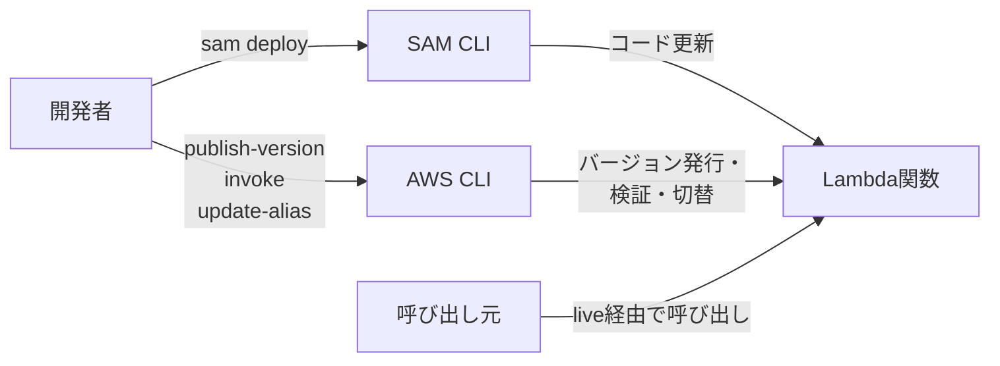
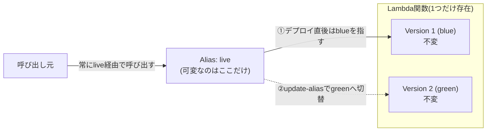
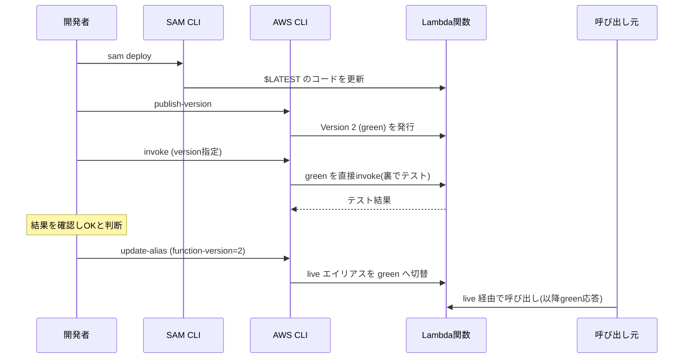

# Lambda Blue/Green デプロイ計画・設計

Issue #1 で検討した計画・設計をまとめたドキュメント。

## 目的

AWS Lambda(Node.js, runtime実行の構成)をBlue/Greenデプロイで試す。

- 重み付け(カナリア/リニアのトラフィックシフト)は使わない
- AWS CodeDeployは使わない
- 「新バージョン(green)をデプロイ → 裏で直接テスト → 問題なければエイリアスを一括切替」という、検証ゲート付きの一括切替方式を採る

## 採用方式

### なぜCodeDeployを使わないか

SAMの `AutoPublishAlias` だけでは、デプロイ時に自動でエイリアスを新バージョンへ向け直してしまい、「テストしてOKなら切り替える」という保留は表現できない。これをマネージドにやろうとすると実質CodeDeployの `AllAtOnce` + Pre-Trafficフックしか選択肢がなくなるため、CodeDeployを使わない方針では採用しない。

### 役割分担

| 役割 | 手段 |
| --- | --- |
| 関数コードのデプロイ(`$LATEST` 更新) | SAM (`sam build && sam deploy`) |
| バージョン発行(green作成) | AWS CLI (`aws lambda publish-version`) |
| greenの検証(裏から直接invoke) | AWS CLI (`aws lambda invoke` にバージョン番号付きARNを指定) |
| エイリアス切替(blue→green一括切替/ロールバック) | AWS CLI (`aws lambda update-alias`) |

SAMで宣言的に管理できる部分(関数本体のコード・設定)はSAMに任せ、「いつ切り替えるか」という判断を伴う操作はCLIで明示的に実行する。SAMのテンプレートには `AutoPublishAlias` や `DeploymentPreference` は設定しない。

### フロー

1. `sam deploy` でLambda関数のコードを更新する(この時点ではエイリアスは一切変わらない。blueがそのまま本番で動き続ける)
2. `aws lambda publish-version` で現在の `$LATEST` から新バージョン(green)を発行する。旧バージョン(blue)はそのまま残る
3. greenのバージョン番号付きARN(例: `...:MyFunction:2`)を直接invokeし、期待する応答が返るか確認する。エイリアス経由ではない(= ルーティング上は本番トラフィックに影響しない)。ただし同時実行数(concurrency)はデフォルトでは関数単位でバージョン/エイリアスをまたいで共有されるため、greenへの直接invokeがblueの同時実行キャパシティと競合する可能性はある。アカウント/関数のconcurrencyに余裕がない場合は注意する(必要ならバージョン別のreserved concurrencyやProvisioned Concurrencyで分離できる)
4. 問題がなければ `aws lambda update-alias --function-name MyFunction --name live --function-version <green>` で `live` エイリアスをblueからgreenへ一括切替する
5. 問題が見つかった場合は `aws lambda update-alias --function-name MyFunction --name live --function-version <blue>` で即座に戻す(ロールバック)

### エイリアス切替時の挙動(ダウンタイムの有無)

Lambdaのエイリアスは「名前→バージョン番号」の単純なポインタであり、`update-alias` はLambdaのコントロールプレーン上でアトミックに即時反映される。

- 呼び出し(Invoke)はリクエスト単位でエイリアスの向き先を解決するため、持続的な接続を維持したまま向き先が変わるという概念がない
- 切替前に実行中だったリクエストはそのまま元のバージョンで完了し、切替後の新規リクエストは新バージョンに飛ぶ。リクエストの欠落やエラーは発生しない
- 唯一の注意点は、切替直後の最初の数リクエストでgreenがコールドスタートし、レイテンシが一時的に増える可能性があること(ダウンタイムではなく応答速度の問題)。気になる場合はProvisioned Concurrencyをgreenに事前割り当てすることもできるが、本検証では必須としない

### greenへの直接テストに関する注意

green(新バージョン)への直接invokeがDBへの書き込みなど外部状態を変更する処理を含む場合、本番データに影響する可能性がある。テスト用の入力やモックで副作用を避けられるようにしておく、もしくは副作用のある処理は切替後にのみ実行されるようにするなど、実装時に検討する。

### エイリアスの状態管理について

`live` エイリアスはSAMテンプレート(CloudFormation)では管理せず、CLIのみで作成・更新する方針のため、スタックの削除・再作成を行ってもエイリアスの向き先はIaC側では復元されない(IaC外の状態としてドリフトする)。スタックを再作成した場合は、エイリアスの再作成・再設定が必要になることを認識しておく。

## システム構成図

誰が何を操作するかだけを示す図。Lambda関数の中(Version/Aliasの詳細)は次の「Lambda関数・Version・Aliasの関係」の図を参照。



- `live` エイリアスはSAM管理外で、AWS CLIからのみ作成・更新する(前述「エイリアスの状態管理について」)
- 呼び出し元は常に `live` エイリアス経由でアクセスし、裏側のバージョン切替を意識しない
- green検証時のみ、エイリアスを経由せずバージョン番号を直接指定してinvokeする

### Lambda関数・Version・Aliasの関係(Blue/Greenの実体)

「Lambda関数」「Version」「Alias」の関係が上の図だけだと分かりにくいため、この3者だけを抜き出して描いたのが以下の図。Blue/Greenデプロイが実際に何をしているかは、この図の①→②がそのものである。



- Lambda関数自体は1つしか存在しない。コードを変更して `publish-version` するたびに、不変な「Version」(blue, greenは呼びやすくするための俗称で、実体はVersion番号)が増えていく
- 可変なのは `live` というAliasが「どのVersionを指しているか」だけ。VersionやLambda関数そのものは切替の前後で変化しない
- Blue/Greenデプロイ = Aliasの向き先をVersion1からVersion2へ一括で切り替える操作そのもの(①→②)。重み付けではなく、ある瞬間に100%が新Versionへ切り替わる
- 呼び出し元は常にAlias経由でアクセスするため、向き先が変わったことを意識せず新バージョンの応答を受け取るようになる

## デプロイ/Blue-Green切替のイメージ

### デプロイ〜検証〜切替のシーケンス



切替前後の状態の違いは、前述の「Lambda関数・Version・Aliasの関係」の図の①(切替前)・②(切替後)に対応する。

## ランタイムについて

Node.js 26を希望しているが、Lambdaの対応ランタイム一覧に存在するかは実装直前にAWSコンソール/ドキュメントで確認する。存在しない場合は、その時点でLambdaがサポートしている最新のNode.jsランタイムにフォールバックする。

## リポジトリ構成(予定)

```
template.yaml              # SAM: 関数本体のみ(AutoPublishAlias/DeploymentPreferenceは使わない)
samconfig.toml              # sam deploy のデフォルト設定
src/main/index.mjs          # 本体Lambda。呼び出されたバージョンが分かる応答を返す
scripts/deploy.sh            # sam build && sam deploy
scripts/publish-version.sh   # aws lambda publish-version (green作成)
scripts/invoke-version.sh    # バージョン番号を指定して裏から直接invoke(テスト用)
scripts/create-alias.sh      # aws lambda create-alias (liveエイリアスの初回作成、初回のみ実行)
scripts/switch-alias.sh      # aws lambda update-alias (blue<->green切替/ロールバック)
scripts/show-alias.sh        # 現在aliasがどのバージョンを指しているか確認
docs/PLAN.md                 # 本ドキュメント
docs/RUNBOOK.md              # 初回構築〜デプロイ〜検証〜切替〜ロールバックの手順書(実装時に追加)
```

## TODO

- [x] 計画・設計をドキュメント化してコミットする(このドキュメント)
- [x] システム構成図・デプロイ/切替イメージ図をドキュメントに追加する
- [ ] Lambdaの対応ランタイム一覧でNode.jsの利用可能バージョンを確認する
- [ ] ローカルのAWS認証情報(プロファイル)がSAM/CLIから使えることを確認する
- [ ] 本体Lambda(`src/main/index.mjs`)を実装する。バージョンが見分けられる応答を返すようにする
- [ ] SAMテンプレート(`template.yaml`)を作成する(`AutoPublishAlias`/`DeploymentPreference`は使わない)
- [ ] CLIスクリプト(`scripts/*.sh`)を作成する: deploy / publish-version / invoke-version / create-alias / switch-alias / show-alias
- [ ] 初回デプロイ(`sam deploy`)してLambda関数(`$LATEST`)を作成する
- [ ] `publish-version` で最初のバージョン(blue=v1)を発行する
- [ ] `create-alias` で `live` エイリアスを初回作成する(v1=blueを指す)。Alias経由の呼び出しを確認する
- [ ] コードを変更して2回目デプロイし、`publish-version` でgreen(v2)を発行する
- [ ] greenを直接invokeして検証する
- [ ] `switch-alias` でblue→greenへ切り替え、Alias経由の呼び出し結果がv2になることを確認する
- [ ] エイリアス切替前後でリクエストが途切れないこと(ダウンタイムがないこと)を実際に確認する
- [ ] ロールバック(green→blue)が機能することを確認する
- [ ] 手順書(`docs/RUNBOOK.md`)をまとめる
- [ ] 不要リソースの後片付け手順を確認する
